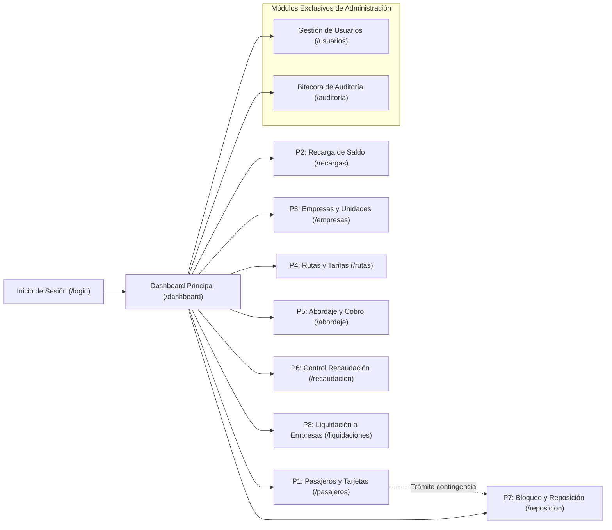

# Mapa de Navegación del Sistema PasaYa

## 1. Diagrama de Flujo de Navegación

El siguiente diagrama modela la arquitectura de navegación entre el acceso inicial, el panel de control central y las pantallas de los ocho (8) procesos transaccionales, integrando los controles de acceso basados en roles (RBAC).

---

## 2. Tabla Detallada de Pantallas y Consumo de Endpoints

| Pantalla | Archivo / Ruta Frontend | Se accede desde | Roles Autorizados | Endpoints que Consume | Acciones y Lógica de Negocio |
| :--- | :--- | :--- | :--- | :--- | :--- |
| **Inicio de Sesión** | `frontend/pages/login.html` | Acceso directo / Redirección | Todos (Público) | `POST /auth/login` | Selección de credenciales o perfil simulado, recepción de token JWT y redirección según rol. |
| **Dashboard Principal** | `frontend/pages/dashboard.html` | `login.html` | Administrador, Operador, Cajero | `GET /recaudaciones`, `GET /viajes`, `GET /auth/perfil` | Visualización de métricas clave (recaudación del día, abordajes, flota activa) y menú lateral dinámico según rol. |
| **P1: Pasajeros y Tarjetas** | `frontend/pages/pasajeros.html` | `dashboard.html` | Administrador, Operador | `GET /pasajeros`, `POST /pasajeros`, `GET /tarjetas`, `POST /tarjetas` | Registro de pasajeros con documento de identidad, validación de caducidad de carné universitario y emisión de código único de tarjeta. |
| **P2: Recarga de Saldo** | `frontend/pages/recargas.html` | `dashboard.html` | Administrador, Cajero | `GET /puntos-recarga`, `GET /tarjetas`, `POST /recargas`, `PATCH /tarjetas/{id}` | Formulario de caja para ingresar efectivo, validación de topes (máx. S/ 100 por abono, saldo acumulado máx. S/ 300) y confirmación visual. |
| **P3: Empresas y Unidades** | `frontend/pages/empresas.html` | `dashboard.html` | Administrador, Operador (lectura) | `GET /empresas`, `POST /empresas`, `GET /conductores`, `GET /unidades`, `POST /unidades` | Alta de empresas con RUC válido (11 dígitos), catálogo de conductores con brevete profesional y registro de flota vehicular. |
| **P4: Rutas y Tarifas** | `frontend/pages/rutas.html` | `dashboard.html` | Administrador, Operador (lectura) | `GET /rutas`, `POST /rutas`, `GET /paraderos`, `GET /tarifas`, `POST /tarifas` | Configuración de corredores viales, paraderos inicial/final y definición de tarifa plana general y estudiantil. |
| **P5: Abordaje y Cobro** | `frontend/pages/abordaje.html` | `dashboard.html` | Administrador, Operador | `GET /unidades`, `GET /rutas`, `GET /tarjetas`, `POST /viajes`, `PATCH /tarjetas/{id}` | **Simulador de validador de bus:** Selección de bus y ruta, ingreso de código de tarjeta, verificación atómica de saldo, débito y emisión de alertas auditivas/visuales. |
| **P6: Control de Recaudación** | `frontend/pages/recaudacion.html` | `dashboard.html` | Administrador, Operador | `GET /recaudaciones`, `GET /viajes`, `POST /recaudaciones/cierre` | Cuadre diario de recaudación por unidad y ruta, comparación de viajes vs. ingresos monetarios y formalización del cierre de caja. |
| **P7: Bloqueo y Reposición** | `frontend/pages/reposicion.html` | `dashboard.html`, `pasajeros.html` | Administrador, Operador | `GET /tarjetas`, `PATCH /tarjetas/{id}/bloqueo`, `POST /reposiciones` | Bloqueo preventivo por robo o pérdida, anulación de la tarjeta previa y transferencia transparente del 100% del saldo al nuevo plástico. |
| **P8: Liquidación a Empresas** | `frontend/pages/liquidaciones.html` | `dashboard.html` | Administrador, Operador (lectura) | `GET /empresas`, `GET /recaudaciones`, `POST /liquidaciones`, `PATCH /liquidaciones/{id}/pagar` | Cálculo del acumulado comercial de la concesionaria, retención del 5% de comisión de PasaYa y registro de orden de pago bancario. |
| **Gestión de Usuarios** | `frontend/pages/usuarios.html` | `dashboard.html` | Administrador | `GET /usuarios`, `POST /usuarios`, `GET /roles` | Mantenimiento de credenciales de acceso, asignación de roles (RBAC) y desactivación de cuentas. |
| **Bitácora de Auditoría** | `frontend/pages/auditoria.html` | `dashboard.html` | Administrador | `GET /auditoria`, `GET /usuarios` | Visor tabular con filtros por fecha, entidad y usuario para cumplimiento normativo y fiscalización. |

---

## 3. Manejo de Estados de Interfaz y Retroalimentación
Todas las pantallas integradas implementan de manera consistente cuatro estados visuales de UX:
1. **Estado de Carga (*Loading State*):** Indicador giratorio (*spinner*) mientras la petición `fetch` se comunica con la API simulada.
2. **Estado Vacío (*Empty State*):** Mensaje amigable con ilustración cuando una consulta no arroja registros (ej. *"No se encontraron viajes para esta unidad"*).
3. **Estado de Éxito (*Success State*):** Banner verde esmeralda emergente (*toast notification*) informando la confirmación de la transacción (ej. *"Recarga de S/ 20.00 efectuada con éxito"*).
4. **Estado de Conflicto o Error (*Error State*):** Banner rojo con el formato estándar `409 Conflict` (ej. *"Cobro rechazado: Saldo insuficiente"*), preservando la estabilidad del formulario sin recargas de página no deseadas.
