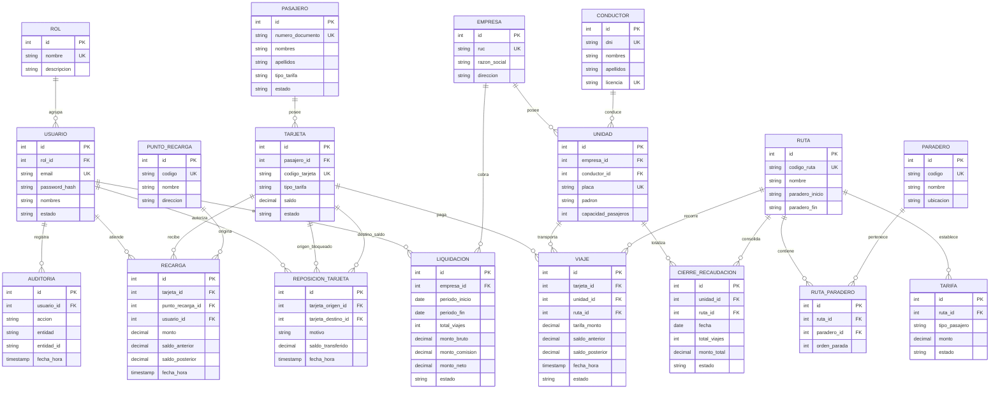

# Modelo de Datos: Sistema PasaYa

## 1. Entidades identificadas

A partir de los requisitos funcionales del proyecto (**PasaYa**) y los requisitos no funcionales de ciberseguridad y arquitectura, se identificaron las siguientes entidades del dominio:

| N.º | Entidad | Justificación y Requisito Asociado | Propósito en el Dominio |
| :---: | :--- | :--- | :--- |
| 1 | `rol` | **RNF-SEG-03 / RNF-SEG-02** | Define los roles de seguridad del sistema (administrador, operador, cajero) para el control de acceso basado en roles (RBAC). |
| 2 | `usuario` | **RF-09 / RNF-SEG-01** | Almacena las cuentas de usuario de la plataforma administrativa con contraseña protegida mediante hash. |
| 3 | `auditoria` | **RF-11 / RNF-SEG-04** | Bitácora inmutable de eventos críticos para trazabilidad y seguridad de la información. |
| 4 | `pasajero` | **RF-01.1** | Representa al usuario final del servicio de transporte, clasificando su condición tarifaria. |
| 5 | `tarjeta` | **RF-01.2 / RF-01.3 / RF-07.1** | Dispositivo electrónico virtual/físico con saldo prepagado y código único intransferible. |
| 6 | `punto_recarga` | **RF-02.1** | Puntos de atención, agencias o tótems autorizados donde se efectúan las recargas en efectivo. |
| 7 | `recarga` | **RF-02.1 / RF-02.2 / RF-02.3** | Transacción financiera de ingreso de dinero y actualización del saldo de una tarjeta. |
| 8 | `empresa` | **RF-03.1 / RF-08.1** | Empresa concesionaria de transporte público operadora de las rutas urbanas. |
| 9 | `conductor` | **RF-03.3** | Personal operativo acreditado para manejar las unidades vehiculares. |
| 10 | `unidad` | **RF-03.2** | Bus de transporte urbano con placa identificatoria, asignado a una empresa y conductor. |
| 11 | `ruta` | **RF-04.1** | Trayecto autorizado de origen a fin que cubre una línea de transporte. |
| 12 | `paradero` | **RF-04.2** | Estaciones o paraderos establecidos formalmente en la ciudad. |
| 13 | `ruta_paradero` | **RF-04.2** | Entidad intermedia que resuelve la relación N:M entre rutas y paraderos, estableciendo el orden de parada. |
| 14 | `tarifa` | **RF-04.3** | Estructura de precios aplicables a una ruta según el tipo de pasajero (general o estudiante). |
| 15 | `viaje` | **RF-05.1 / RF-05.2 / RF-05.3** | Transacción de cobro automático por abordaje y débito del saldo de la tarjeta. |
| 16 | `cierre_recaudacion` | **RF-06.1 / RF-06.2** | Consolidación y arqueo transaccional de viajes y recaudación por bus, ruta y fecha. |
| 17 | `reposicion_tarjeta` | **RF-07.1 / RF-07.2** | Registro de contingencia para bloqueo por robo/pérdida y traspaso de saldo a un nuevo plástico. |
| 18 | `liquidacion` | **RF-08.1 / RF-08.2** | Transacción contable periódica de pago devengado a cada empresa descontando la comisión del sistema. |

---

## 2. Diccionario de datos

### 2.1. Entidad: `rol`
| Atributo | Tipo Conceptual | Obligatorio | Único | Regla o Descripción | Requisito |
| :--- | :--- | :---: | :---: | :--- | :--- |
| `id` | Entero | Sí | Sí | Identificador clave primaria del rol. | RNF-SEG-03 |
| `nombre` | Texto | Sí | Sí | Nombre del rol: `administrador`, `operador`, `cajero`. | RNF-SEG-03 |
| `descripcion` | Texto | No | No | Explicación de privilegios y alcance del rol. | RNF-SEG-03 |
| `creado_en` | Fecha y hora | Sí | No | Fecha de creación del registro. | RNF-INT-01 |

### 2.2. Entidad: `usuario`
| Atributo | Tipo Conceptual | Obligatorio | Único | Regla o Descripción | Requisito |
| :--- | :--- | :---: | :---: | :--- | :--- |
| `id` | Entero | Sí | Sí | Identificador clave primaria del usuario. | RF-09 |
| `rol_id` | Entero (FK) | Sí | No | Clave foránea referenciando a `rol(id)`. | RNF-SEG-03 |
| `nombres` | Texto | Sí | No | Nombres del usuario del sistema. | RF-09 |
| `apellidos` | Texto | Sí | No | Apellidos del usuario. | RF-09 |
| `email` | Texto | Sí | Sí | Correo corporativo único para login. | RF-09 |
| `password_hash` | Texto | Sí | No | Contraseña cifrada (Argon2id/bcrypt), jamás texto plano. | RNF-SEG-01 |
| `estado` | Texto | Sí | No | `activo` o `inactivo`. Por defecto `activo`. | RF-09 |
| `creado_en` | Fecha y hora | Sí | No | Marca temporal de alta. | RNF-INT-01 |
| `actualizado_en`| Fecha y hora | Sí | No | Marca temporal de última modificación. | RNF-INT-01 |

### 2.3. Entidad: `auditoria`
| Atributo | Tipo Conceptual | Obligatorio | Único | Regla o Descripción | Requisito |
| :--- | :--- | :---: | :---: | :--- | :--- |
| `id` | Entero | Sí | Sí | Identificador único del evento. | RF-11 |
| `usuario_id` | Entero (FK) | No | No | Usuario que generó el evento (NULL si es proceso del sistema). | RF-11 |
| `accion` | Texto | Sí | No | `INSERT`, `UPDATE`, `DELETE`, `LOGIN`, `RECARGA`, `COBRO`. | RF-11 |
| `entidad` | Texto | Sí | No | Tabla afectada (ej. `tarjeta`, `viaje`, `recarga`). | RF-11 |
| `entidad_id` | Texto | No | No | Identificador del registro modificado. | RF-11 |
| `detalles` | Texto | No | No | Payload en JSON o descripción textual de los cambios. | RF-11 |
| `ip_origen` | Texto | No | No | Dirección IP del cliente que solicitó la operación. | RNF-SEG-04 |
| `fecha_hora` | Fecha y hora | Sí | No | Marca temporal exacta e inmutable del evento. | RNF-SEG-04 |

### 2.4. Entidad: `pasajero`
| Atributo | Tipo Conceptual | Obligatorio | Único | Regla o Descripción | Requisito |
| :--- | :--- | :---: | :---: | :--- | :--- |
| `id` | Entero | Sí | Sí | Identificador clave primaria del pasajero. | RF-01.1 |
| `tipo_documento`| Texto | Sí | No | `DNI`, `CE`, `PASAPORTE`. | RF-01.1 |
| `numero_documento`| Texto | Sí | Sí | Número de documento de identidad oficial. | RF-01.1 |
| `nombres` | Texto | Sí | No | Nombres completos del pasajero. | RF-01.1 |
| `apellidos` | Texto | Sí | No | Apellidos del pasajero. | RF-01.1 |
| `telefono` | Texto | No | No | Teléfono celular de contacto. | RF-01.1 |
| `email` | Texto | No | Sí | Correo electrónico para notificaciones. | RF-01.1 |
| `tipo_tarifa` | Texto | Sí | No | `general` o `estudiante`. | RF-01.1 |
| `fecha_vencimiento_estudiante` | Fecha | No | No | Obligatorio si `tipo_tarifa = 'estudiante'`. | RF-01.3 |
| `estado` | Texto | Sí | No | `activo` o `inactivo`. Por defecto `activo`. | RF-01.1 |
| `creado_en` | Fecha y hora | Sí | No | Timestamp de registro del pasajero. | RNF-INT-01 |

### 2.5. Entidad: `tarjeta`
| Atributo | Tipo Conceptual | Obligatorio | Único | Regla o Descripción | Requisito |
| :--- | :--- | :---: | :---: | :--- | :--- |
| `id` | Entero | Sí | Sí | Identificador clave primaria de la tarjeta. | RF-01.2 |
| `codigo_tarjeta`| Texto | Sí | Sí | Código alfanumérico único impreso o virtual (ej. `TARJ-1001`). | RF-01.2 |
| `pasajero_id` | Entero (FK) | Sí | No | Pasajero titular de la tarjeta (`pasajero(id)`). | RF-01.2 |
| `tipo_tarifa` | Texto | Sí | No | Heredada del pasajero: `general` o `estudiante`. | RF-01.2 |
| `saldo` | Decimal | Sí | No | Saldo monetario prepago. `saldo >= 0.00`. Por defecto `0.00`. | RF-02.3 |
| `estado` | Texto | Sí | No | `activa`, `bloqueada`, `reemplazada`. Por defecto `activa`. | RF-07.1 |
| `fecha_emision`| Fecha y hora | Sí | No | Momento en que la tarjeta fue dada de alta. | RF-01.2 |
| `actualizado_en`| Fecha y hora | Sí | No | Momento de última actualización de saldo o estado. | RNF-INT-01 |

### 2.6. Entidad: `punto_recarga`
| Atributo | Tipo Conceptual | Obligatorio | Único | Regla o Descripción | Requisito |
| :--- | :--- | :---: | :---: | :--- | :--- |
| `id` | Entero | Sí | Sí | Identificador clave primaria del punto. | RF-02.1 |
| `codigo` | Texto | Sí | Sí | Código de agencia o terminal (ej. `PTO-01`). | RF-02.1 |
| `nombre` | Texto | Sí | No | Nombre descriptivo del punto de recarga. | RF-02.1 |
| `direccion` | Texto | Sí | No | Ubicación física o paradero referencial. | RF-02.1 |
| `estado` | Texto | Sí | No | `activo` o `inactivo`. | RF-02.1 |

### 2.7. Entidad: `recarga`
| Atributo | Tipo Conceptual | Obligatorio | Único | Regla o Descripción | Requisito |
| :--- | :--- | :---: | :---: | :--- | :--- |
| `id` | Entero | Sí | Sí | Identificador único de la transacción de recarga. | RF-02.1 |
| `tarjeta_id` | Entero (FK) | Sí | No | Tarjeta receptora del saldo (`tarjeta(id)`). | RF-02.1 |
| `punto_recarga_id` | Entero (FK) | Sí | No | Punto donde se realizó la recarga (`punto_recarga(id)`). | RF-02.1 |
| `usuario_id` | Entero (FK) | Sí | No | Cajero u operador que atendió (`usuario(id)`). | RF-02.1 |
| `monto` | Decimal | Sí | No | Importe recargado. `monto > 0.00` y `monto <= 100.00`. | RF-02.3 |
| `saldo_anterior`| Decimal | Sí | No | Saldo de la tarjeta previo al abono. | RF-02.2 |
| `saldo_posterior`| Decimal | Sí | No | `saldo_anterior + monto`. Máximo permitido S/ 300.00. | RF-02.3 |
| `fecha_hora` | Fecha y hora | Sí | No | Momento exacto de confirmación de la recarga. | RF-02.2 |

### 2.8. Entidad: `empresa`
| Atributo | Tipo Conceptual | Obligatorio | Único | Regla o Descripción | Requisito |
| :--- | :--- | :---: | :---: | :--- | :--- |
| `id` | Entero | Sí | Sí | Identificador clave primaria de la empresa. | RF-03.1 |
| `ruc` | Texto | Sí | Sí | Registro Único de Contribuyentes (11 dígitos). | RF-03.1 |
| `razon_social` | Texto | Sí | No | Razón social formal de la concesionaria. | RF-03.1 |
| `direccion` | Texto | Sí | No | Domicilio fiscal y administrativo. | RF-03.1 |
| `telefono` | Texto | No | No | Teléfono de central de operaciones. | RF-03.1 |
| `estado` | Texto | Sí | No | `activa` o `inactiva`. | RF-03.1 |

### 2.9. Entidad: `conductor`
| Atributo | Tipo Conceptual | Obligatorio | Único | Regla o Descripción | Requisito |
| :--- | :--- | :---: | :---: | :--- | :--- |
| `id` | Entero | Sí | Sí | Identificador clave primaria del conductor. | RF-03.3 |
| `dni` | Texto | Sí | Sí | Documento Nacional de Identidad (8 dígitos). | RF-03.3 |
| `nombres` | Texto | Sí | No | Nombres del conductor. | RF-03.3 |
| `apellidos` | Texto | Sí | No | Apellidos del conductor. | RF-03.3 |
| `licencia` | Texto | Sí | Sí | Número de brevete profesional (ej. A-IIIa o A-IIIc). | RF-03.3 |
| `telefono` | Texto | No | No | Celular de contacto. | RF-03.3 |
| `estado` | Texto | Sí | No | `activo` o `inactivo`. | RF-03.3 |

### 2.10. Entidad: `unidad`
| Atributo | Tipo Conceptual | Obligatorio | Único | Regla o Descripción | Requisito |
| :--- | :--- | :---: | :---: | :--- | :--- |
| `id` | Entero | Sí | Sí | Identificador clave primaria del bus. | RF-03.2 |
| `empresa_id` | Entero (FK) | Sí | No | Empresa concesionaria propietaria (`empresa(id)`). | RF-03.2 |
| `conductor_id`| Entero (FK) | No | No | Conductor asignado actualmente (`conductor(id)`). | RF-03.2 |
| `placa` | Texto | Sí | Sí | Placa de rodaje única (ej. `ABC-123`). | RF-03.2 |
| `padron` | Texto | Sí | No | Número de padrón interno del bus en la empresa. | RF-03.2 |
| `capacidad_pasajeros`| Entero | Sí | No | Capacidad total de transporte. `capacidad > 0`. | RF-03.2 |
| `estado` | Texto | Sí | No | `operativo`, `en_mantenimiento`, `baja`. | RF-03.2 |

### 2.11. Entidad: `ruta`
| Atributo | Tipo Conceptual | Obligatorio | Único | Regla o Descripción | Requisito |
| :--- | :--- | :---: | :---: | :--- | :--- |
| `id` | Entero | Sí | Sí | Identificador clave primaria de la ruta. | RF-04.1 |
| `codigo_ruta` | Texto | Sí | Sí | Código de línea o ruta (ej. `R-101`, `LINEA-B`). | RF-04.1 |
| `nombre` | Texto | Sí | No | Denominación común (ej. `Ate - Callao`). | RF-04.1 |
| `paradero_inicio`| Texto | Sí | No | Terminal o paradero de salida. | RF-04.1 |
| `paradero_fin` | Texto | Sí | No | Terminal o paradero de llegada. | RF-04.1 |
| `distancia_km` | Decimal | Sí | No | Longitud total del recorrido en kilómetros. | RF-04.1 |
| `estado` | Texto | Sí | No | `activa` o `inactiva`. | RF-04.1 |

### 2.12. Entidad: `paradero`
| Atributo | Tipo Conceptual | Obligatorio | Único | Regla o Descripción | Requisito |
| :--- | :--- | :---: | :---: | :--- | :--- |
| `id` | Entero | Sí | Sí | Identificador clave primaria del paradero. | RF-04.2 |
| `codigo` | Texto | Sí | Sí | Código de paradero oficial (ej. `PAR-05`). | RF-04.2 |
| `nombre` | Texto | Sí | No | Nombre del paradero o cruce vial. | RF-04.2 |
| `ubicacion` | Texto | Sí | No | Distrito o coordenada referencial. | RF-04.2 |

### 2.13. Entidad: `ruta_paradero` (Entidad Intermedia N:M)
| Atributo | Tipo Conceptual | Obligatorio | Único | Regla o Descripción | Requisito |
| :--- | :--- | :---: | :---: | :--- | :--- |
| `id` | Entero | Sí | Sí | Identificador del paradero en la ruta. | RF-04.2 |
| `ruta_id` | Entero (FK) | Sí | No | Ruta correspondiente (`ruta(id)`). | RF-04.2 |
| `paradero_id`| Entero (FK) | Sí | No | Paradero asignado (`paradero(id)`). | RF-04.2 |
| `orden_parada`| Entero | Sí | No | Posición secuencial de parada en la ruta (1, 2, 3...). | RF-04.2 |

### 2.14. Entidad: `tarifa`
| Atributo | Tipo Conceptual | Obligatorio | Único | Regla o Descripción | Requisito |
| :--- | :--- | :---: | :---: | :--- | :--- |
| `id` | Entero | Sí | Sí | Identificador de la tarifa. | RF-04.3 |
| `ruta_id` | Entero (FK) | Sí | No | Ruta vinculada (`ruta(id)`). | RF-04.3 |
| `tipo_pasajero`| Texto | Sí | No | `general` o `estudiante`. | RF-04.3 |
| `monto` | Decimal | Sí | No | Valor monetario del pasaje. `monto > 0.00`. | RF-04.3 |
| `estado` | Texto | Sí | No | `vigente` o `historica`. Por defecto `vigente`. | RF-04.3 |

### 2.15. Entidad: `viaje`
| Atributo | Tipo Conceptual | Obligatorio | Único | Regla o Descripción | Requisito |
| :--- | :--- | :---: | :---: | :--- | :--- |
| `id` | Entero | Sí | Sí | Identificador único de transacción de viaje. | RF-05.1 |
| `tarjeta_id` | Entero (FK) | Sí | No | Tarjeta con la que se abordó (`tarjeta(id)`). | RF-05.1 |
| `unidad_id` | Entero (FK) | Sí | No | Bus donde se realiza el abordaje (`unidad(id)`). | RF-05.1 |
| `ruta_id` | Entero (FK) | Sí | No | Ruta del recorrido (`ruta(id)`). | RF-05.1 |
| `tarifa_monto`| Decimal | Sí | No | Monto cobrado por el viaje. | RF-05.2 |
| `saldo_anterior`| Decimal | Sí | No | Saldo de la tarjeta al momento de apoyar el plástico. | RF-05.2 |
| `saldo_posterior`| Decimal | Sí | No | Saldo resultante tras el débito. | RF-05.2 |
| `fecha_hora` | Fecha y hora | Sí | No | Momento exacto de abordaje y validación. | RF-05.2 |
| `estado` | Texto | Sí | No | `exitoso`, `rechazado_saldo_insuficiente`, `rechazado_bloqueada`. | RF-05.3 |

### 2.16. Entidad: `cierre_recaudacion`
| Atributo | Tipo Conceptual | Obligatorio | Único | Regla o Descripción | Requisito |
| :--- | :--- | :---: | :---: | :--- | :--- |
| `id` | Entero | Sí | Sí | Identificador del arqueo de recaudación. | RF-06.1 |
| `unidad_id` | Entero (FK) | Sí | No | Unidad auditada (`unidad(id)`). | RF-06.1 |
| `ruta_id` | Entero (FK) | Sí | No | Ruta auditada (`ruta(id)`). | RF-06.1 |
| `fecha` | Fecha | Sí | No | Fecha correspondiente a la jornada consolidada. | RF-06.1 |
| `total_viajes`| Entero | Sí | No | Conteo de viajes válidos efectuados en el día. | RF-06.1 |
| `monto_total` | Decimal | Sí | No | Sumatoria total de pasajes cobrados. | RF-06.1 |
| `estado` | Texto | Sí | No | `pendiente`, `cerrado`, `liquidado`. | RF-06.2 |
| `fecha_cierre`| Fecha y hora | Sí | No | Momento en que se ejecuta el cierre. | RF-06.2 |

### 2.17. Entidad: `reposicion_tarjeta`
| Atributo | Tipo Conceptual | Obligatorio | Único | Regla o Descripción | Requisito |
| :--- | :--- | :---: | :---: | :--- | :--- |
| `id` | Entero | Sí | Sí | Identificador de reposición y migración. | RF-07.2 |
| `tarjeta_origen_id`| Entero (FK) | Sí | No | Tarjeta extraviada/dañada que se anula (`tarjeta(id)`). | RF-07.1 |
| `tarjeta_destino_id`| Entero (FK)| Sí | No | Nueva tarjeta emitida que recibe el saldo (`tarjeta(id)`).| RF-07.2 |
| `motivo` | Texto | Sí | No | `perdida`, `robo`, `deterioro`. | RF-07.1 |
| `saldo_transferido`| Decimal | Sí | No | Importe monetario migrado entre plásticos. | RF-07.2 |
| `fecha_hora` | Fecha y hora | Sí | No | Timestamp de la operación atómica de reposición. | RF-07.2 |
| `usuario_id` | Entero (FK) | Sí | No | Operador administrativo que procesó el trámite. | RF-07.2 |

### 2.18. Entidad: `liquidacion`
| Atributo | Tipo Conceptual | Obligatorio | Único | Regla o Descripción | Requisito |
| :--- | :--- | :---: | :---: | :--- | :--- |
| `id` | Entero | Sí | Sí | Identificador de la orden contable de liquidación. | RF-08.1 |
| `empresa_id` | Entero (FK) | Sí | No | Concesionaria beneficiaria (`empresa(id)`). | RF-08.1 |
| `periodo_inicio`| Fecha | Sí | No | Fecha inicio del rango liquidado. | RF-08.1 |
| `periodo_fin` | Fecha | Sí | No | Fecha fin del rango liquidado. | RF-08.1 |
| `total_viajes`| Entero | Sí | No | Cantidad consolidada de viajes de la flota. | RF-08.1 |
| `monto_bruto` | Decimal | Sí | No | Recaudación total de pasajes de la empresa. | RF-08.1 |
| `porcentaje_comision`| Decimal | Sí | No | Tasa de retención PasaYa (ej. `5.00` %). | RF-08.2 |
| `monto_comision`| Decimal | Sí | No | `monto_bruto * (porcentaje_comision / 100)`. | RF-08.2 |
| `monto_neto` | Decimal | Sí | No | `monto_bruto - monto_comision`. Saldo a depositar. | RF-08.2 |
| `estado` | Texto | Sí | No | `calculada`, `pagada`, `anulada`. | RF-08.2 |
| `fecha_liquidacion`| Fecha y hora | Sí | No | Momento de cálculo y emisión. | RF-08.2 |
| `usuario_id` | Entero (FK) | Sí | No | Administrador financiero que autoriza. | RF-08.2 |

---

## 3. Relaciones y cardinalidades

- **`rol` y `usuario` (1:N):** Un rol agrupa a muchos usuarios; un usuario posee exactamente un rol.
- **`usuario` y `auditoria` (1:N):** Un usuario genera cero o muchas entradas en auditoría; cada auditoría referencia a lo sumo a un usuario.
- **`pasajero` y `tarjeta` (1:N):** Un pasajero puede tener históricamente una o más tarjetas (emisión original y reposiciones), pero cada tarjeta pertenece a un único pasajero.
- **`tarjeta` y `recarga` (1:N):** Una tarjeta recibe cero o muchas recargas; cada recarga incrementa el saldo de exactamente una tarjeta.
- **`punto_recarga` y `recarga` (1:N):** Un punto de recarga procesa muchas recargas; cada recarga ocurre en un punto de recarga.
- **`empresa` y `unidad` (1:N):** Una empresa opera muchos buses; cada bus pertenece estrictamente a una empresa concesionaria.
- **`conductor` y `unidad` (1:N):** Un conductor puede estar asignado a una o varias unidades a lo largo del tiempo, pero en un momento dado una unidad tiene asignado a un conductor.
- **`ruta` y `paradero` (N:M con entidad intermedia `ruta_paradero`):** Una ruta atraviesa múltiples paraderos en un orden específico, y un paradero urbano puede ser compartido por diversas rutas. Resuelto limpiamente con `ruta_paradero`.
- **`ruta` y `tarifa` (1:N):** Una ruta tiene asociadas diversas tarifas (general y estudiante).
- **`tarjeta` y `viaje` (1:N):** Una tarjeta realiza cero o muchos viajes; cada viaje se ejecuta con una tarjeta.
- **`unidad` y `viaje` (1:N):** Un bus registra muchos viajes a lo largo de su jornada.
- **`ruta` y `viaje` (1:N):** Cada viaje se realiza dentro del recorrido de una ruta específica.
- **`unidad` y `cierre_recaudacion` (1:N):** Cada unidad acumula cierres diarios de recaudación.
- **`tarjeta` y `reposicion_tarjeta` (1:N en origen y destino):** Una tarjeta puede ser la fuente bloqueada de una reposición o el destino receptor del saldo traspasado.
- **`empresa` y `liquidacion` (1:N):** Una empresa recibe periódicamente liquidaciones de pago por los viajes acumulados por su flota.

---

## 4. Diagrama entidad-relación

---

## 5. Matriz CRUD proceso-entidad

A continuación se vinculan los 8 procesos transaccionales del proyecto y las acciones del sistema con las entidades del modelo:

| Proceso / Operación | `rol` | `usuario` | `auditoria` | `pasajero` | `tarjeta` | `punto_recarga` | `recarga` | `empresa` | `conductor` | `unidad` | `ruta` | `paradero` | `tarifa` | `viaje` | `cierre_recaudacion` | `reposicion_tarjeta` | `liquidacion` |
| :--- | :---: | :---: | :---: | :---: | :---: | :---: | :---: | :---: | :---: | :---: | :---: | :---: | :---: | :---: | :---: | :---: | :---: |
| **Inicio de sesión (Auth)** | R | R | C | - | - | - | - | - | - | - | - | - | - | - | - | - | - |
| **P1: Pasajeros y Tarjetas** | - | - | C | **C R U** | **C R U** | - | - | - | - | - | - | - | - | - | - | - | - |
| **P2: Recarga de Saldo** | - | R | C | - | **R U** | R | **C R** | - | - | - | - | - | - | - | - | - | - |
| **P3: Empresas y Unidades** | - | - | C | - | - | - | - | **C R U** | **C R U** | **C R U** | - | - | - | - | - | - | - |
| **P4: Rutas y Tarifas** | - | - | C | - | - | - | - | - | - | - | **C R U** | **C R** | **C R U** | - | - | - | - |
| **P5: Viajes (Abordaje)** | - | - | C | - | **R U** | - | - | - | - | R | R | - | R | **C R** | - | - | - |
| **P6: Control Recaudación**| - | - | C | - | - | - | - | - | - | R | R | - | - | R | **C R U** | - | - |
| **P7: Bloqueo y Reposición**| - | R | C | R | **R U C** | - | - | - | - | - | - | - | - | - | - | **C R** | - |
| **P8: Liquidación Empresas**| - | R | C | - | - | - | - | R | - | - | - | - | - | - | R U | - | **C R U** |
| **Gestión Usuarios/Admin** | R | **C R U** | C | - | - | - | - | - | - | - | - | - | - | - | - | - | - |

**Comprobación de reglas:**
- Todo proceso genera trazabilidad registrando al menos un evento en `auditoria`.
- Toda entidad cuenta con al menos un proceso que efectúa su creación (`C`).
- La integridad referencial asegura que las operaciones atómicas sobre saldos (`recarga`, `viaje`, `reposicion_tarjeta`) mantengan consistencia total sin efectos colaterales huérfanos.

---

## 6. Decisiones de diseño y preguntas resueltas

1. **Cumplimiento de la 3FN (Tercera Forma Normal):**
   - El saldo se almacena en `tarjeta` y no se duplica en `pasajero`.
   - La tarifa histórica aplicada al viaje queda congelada en `viaje(tarifa_monto)` para garantizar inmutabilidad financiera aun si la tarifa de la ruta cambia en el futuro.
   - Las relaciones N:M entre rutas y paraderos se desacoplan formalmente mediante la tabla intermedia `ruta_paradero`.
2. **Desacoplamiento de Hardware Físico:**
   - La tarjeta utiliza un código alfanumérico identificador (`codigo_tarjeta`) compatible tanto con lectores físicos (NFC/código de barras) como con la simulación web requerida por la metodología Vibe Coding.
3. **Cero almacenamiento en texto plano:**
   - Se estipula el campo `password_hash` con longitud de 255 caracteres para soportar hashes bcrypt/Argon2id.

---

## 7. Modelo físico para PostgreSQL 17

### 7.1. Mapeo de Tipos de Datos y Restricciones Físicas

| Tipo Conceptual | Tipo PostgreSQL 17 | Restricciones Comunes |
| :--- | :--- | :--- |
| Identificador autonumérico | `INTEGER GENERATED ALWAYS AS IDENTITY` | `PRIMARY KEY` |
| Código / Identificador único | `VARCHAR(30)` / `VARCHAR(50)` | `NOT NULL UNIQUE` |
| Nombres / Cadenas estándar | `VARCHAR(100)` / `VARCHAR(150)` | `NOT NULL` |
| Documentos (DNI, RUC) | `VARCHAR(11)` | `NOT NULL UNIQUE` |
| Importes Monetarios / Saldos | `NUMERIC(10,2)` | `NOT NULL CHECK (campo >= 0.00)` |
| Estados con lista fija | `VARCHAR(30)` | `NOT NULL CHECK (campo IN (...))` |
| Fechas y Horas | `TIMESTAMP WITH TIME ZONE` | `NOT NULL DEFAULT CURRENT_TIMESTAMP` |
| Fechas de calendario | `DATE` | `NOT NULL` |

### 7.2. Acciones Referenciales `ON DELETE`
- **`ON DELETE RESTRICT` (Por defecto en todas las entidades transaccionales y maestras):**
  - Impedir borrar un pasajero que tenga tarjetas emitidas.
  - Impedir borrar una tarjeta con viajes o recargas registradas.
  - Impedir borrar una empresa o bus con recaudación histórica asociada.
- **`ON DELETE CASCADE` (Exclusivo para tablas dependientes de configuración):**
  - Si se elimina una `ruta` que no ha iniciado operaciones comerciales, sus paradas intermedias en `ruta_paradero` se eliminan en cascada.

### 7.3. Índices Propuestos para Optimización de Consultas
- `idx_tarjeta_codigo`: B-Tree sobre `tarjeta(codigo_tarjeta)` para validación de abordaje ultrarrápida (<5 ms).
- `idx_viaje_tarjeta_fecha`: B-Tree compuesto sobre `viaje(tarjeta_id, fecha_hora)` para consultar historial de viajes del usuario.
- `idx_viaje_unidad_fecha`: B-Tree compuesto sobre `viaje(unidad_id, fecha_hora)` para acelerar el consolidado del Proceso 6 (Recaudación).
- `idx_recarga_tarjeta`: B-Tree sobre `recarga(tarjeta_id)` para auditoría y arqueo de saldo.
- `idx_usuario_email`: B-Tree sobre `usuario(email)` para agilizar el login.

### 7.4. Reglas Validadas en el Backend (Capa de Servicios)
1. **Comprobación de Saldo Suficiente al Abordar:** `tarjeta.saldo >= tarifa.monto`. Si no cumple, el backend retorna código HTTP 409 (*Conflict: Saldo insuficiente*).
2. **Validación de Carné Universitario Caducado:** Si la fecha actual supera `pasajero.fecha_vencimiento_estudiante`, el backend liquida el viaje con tarifa `general`.
3. **Bloqueo Atómico de Tarjeta Origen:** La transferencia de saldo en reposición se envuelve en un bloque transaccional `BEGIN ... COMMIT` para evitar doble gasto.
